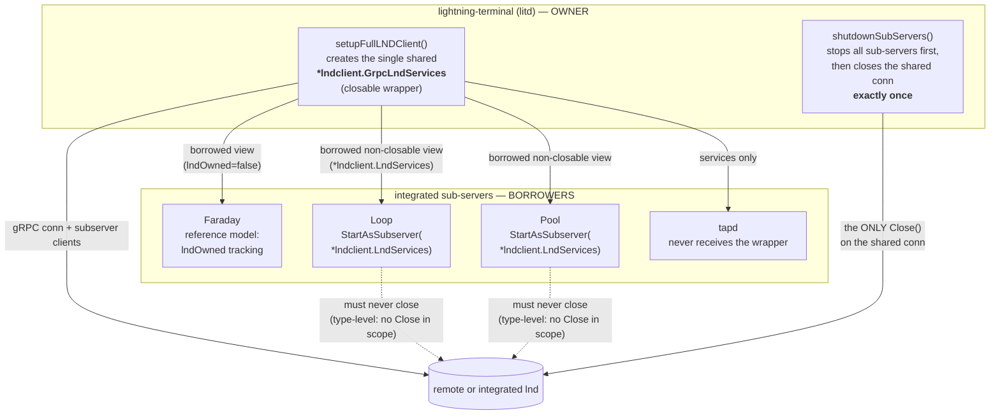
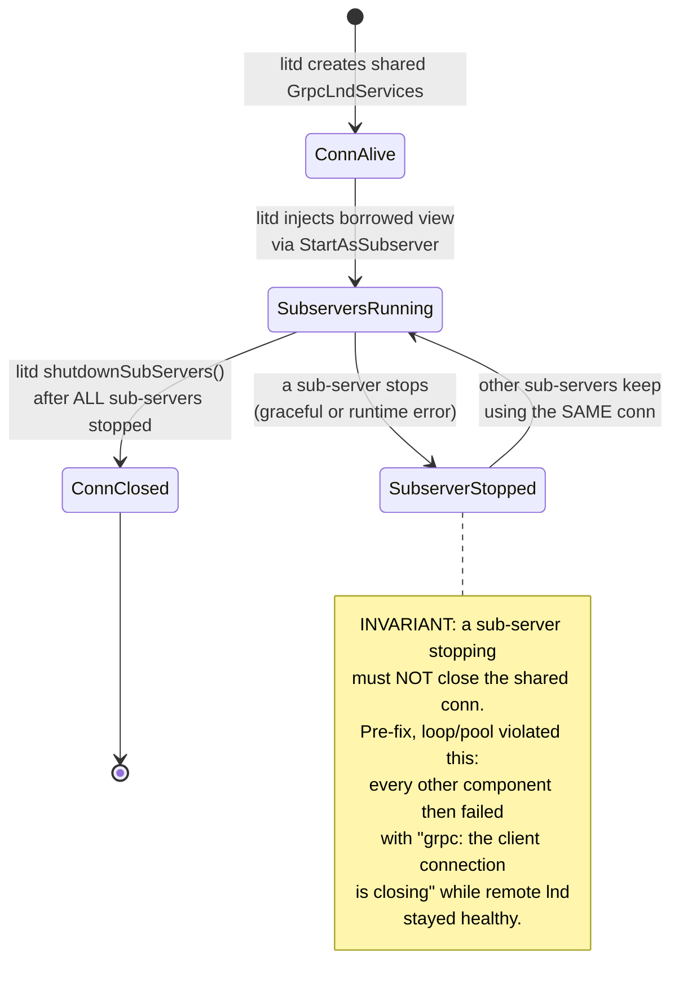

# Sub-server lnd connection ownership

This document describes how the single lnd connection inside `litd` is owned,
shared with the integrated sub-servers (Faraday, Loop, Pool, tapd), and shut
down. It is the authoritative reference for the connection-ownership model
that fixed the bug class reported in
[lightning-terminal#1381](https://github.com/lightninglabs/lightning-terminal/issues/1381#issuecomment-6530026672).

## The ownership model

`litd` creates exactly one `*lndclient.GrpcLndServices` (the shared lnd
connection) and is its sole owner. Only the owner may close it, and it does so
exactly once, in `shutdownSubServers` (`terminal.go`), after all sub-servers
have been stopped.

Integrated sub-servers never receive the closable wrapper. They receive a
**borrowed, non-closable view** (`*lndclient.LndServices`) through
`StartAsSubserver` and must never close it — with the type-level fix in
[loop#1272](https://github.com/lightninglabs/loop/pull/1272) and
[pool#528](https://github.com/lightninglabs/pool/pull/528), they cannot close
it even accidentally, because the `Close` method only exists on the wrapper,
which they never see. On the `litd` side, `subservers/loop.go` and
`subservers/pool.go` hand over that view as `&lndGrpc.LndServices`.

## Lifecycle and failure mode

### The bug that motivated this model

Before the fix, an embedded Loop daemon closed the shared connection on
**any** shutdown — graceful `Stop()` or a runtime error — and an embedded Pool
server did the same in `Server.Stop()`. The moment one sub-server stopped, the
connection every other component depends on was torn down: the LiT macaroon
service (`signrpc.DeriveSharedKey`), tapd, faraday and accounts all failed
with `grpc: the client connection is closing`, while the remote lnd itself was
perfectly healthy. In the reported incident (litd v0.17.8, remote lnd
v0.21.4-beta), this happened 12ms after "Starting LiT macaroon service".

### Historical note: Faraday's `lndOwned` flag

Faraday was the reference model for the first layer of the fix: it tracks
whether it created the connection itself (`lndOwned`, set in `Start`) and only
closes the connection when it owns it. Loop and Pool now go one step further
with **type-level prevention**: instead of a runtime flag, they hold the
closable wrapper only in a dedicated owner field (`lndOwner`, non-nil only in
standalone mode), and their `StartAsSubserver` entry points accept only the
non-closable `*lndclient.LndServices` view. Borrowed-ness is thereby
unrepresentable — enforced by the type checker, not by convention.

## The rules

1. `litd` owns the shared `GrpcLndServices` and closes it exactly once, in
   `shutdownSubServers`, after all sub-servers are stopped.
2. Sub-servers receive a borrowed, non-closable view via `StartAsSubserver`.
   They must never close the connection — and cannot, by construction.
3. Standalone daemons (loopd, poold, faraday running alone, or the loop
   `view` command) create their own connection and close it when done.
4. A sub-server that needs to signal a fatal error reports it to the parent
   (e.g. Loop's `ErrChan`) — it never "cleans up" shared state itself.

## Verification

The ownership model is enforced mechanically on three levels, so this bug
class cannot silently recur:

- **Type level (compile time):** `StartAsSubserver` in Loop and Pool accepts
  only the non-closable `*lndclient.LndServices`. The closable wrapper exists
  in the sub-server packages only as the `lndOwner` field, set solely on the
  standalone path. Judge: the type checker.
- **Regression tests:** `loopd/daemon_ownership_test.go` and
  `server_ownership_test.go` (pool) start an embedded daemon/server against a
  real (bufconn) gRPC connection and assert the injected `grpc.ClientConn`
  does not enter `Shutdown` state after a graceful stop or a runtime-error
  stop. Both tests were demonstrated to fail on the pre-fix code.
- **Static guard:** `loopd/ownership_guard_test.go` and
  `server_ownership_guard_test.go` (pool) parse the package AST in CI (as
  ordinary unit tests) and fail if any `.Close()` call targets an lnd
  connection handle outside the whitelisted owner sites, or if
  `StartAsSubserver` ever accepts the closable wrapper again. Both guards were
  demonstrated to fail on the pre-fix code.
